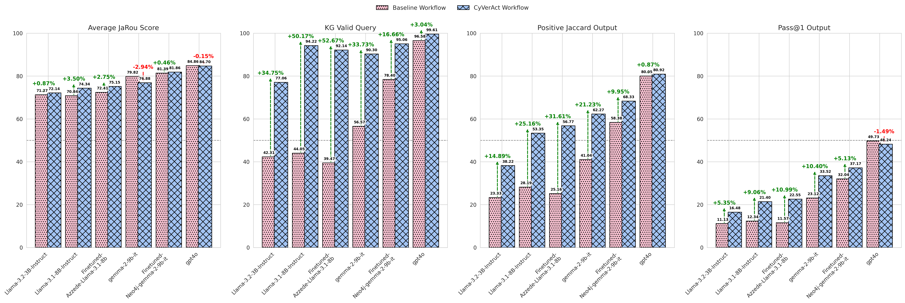
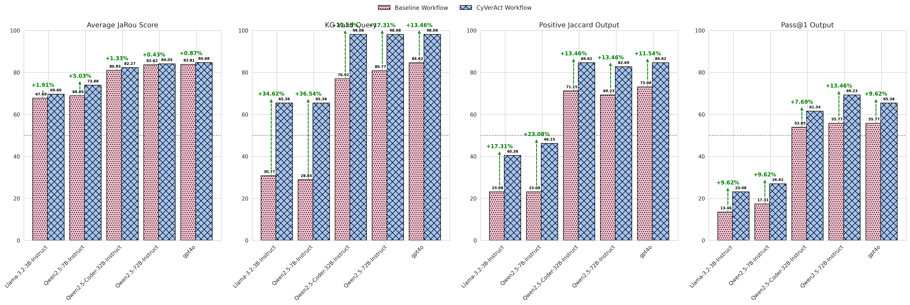

# CyVerACT: An Agentic Cypher Translation workflow over Knowledge Graphs

The proposed CyVeACT workflow for Text-to-Cypher generation is developped using **LangGraph**.

***Note***: Please ensure you're using **Python 3.11**.  This version is required for best compatibility with **LangGraph**.

## CyVerACT Workflow

## Datasets

The CyVerACT workflow was evaluated on two public Text-to-Cypher datasets in the `data/` folder:

* **Neo4j Benchmark dataset** (latest version 2025)

    Latest Version: [neo4j/text2cypher-2025v1](https://huggingface.co/datasets/neo4j/text2cypher-2025v1)
    
    First Version: [neo4j/text2cypher-2024v1](https://huggingface.co/datasets/neo4j/text2cypher-2024v1)
    
    See Article on the datasets: [here](https://neo4j.com/blog/developer/text2cypher-model-struggles-dataset-improvements/)
* **SustainGraoh dataset**: 

    Version: [sustaingraph/dataset](https://gitlab.com/netmode/sustaingraph_llm_evaluation/-/tree/main/Evaluation%20LLMs/Evaluation%20Dataset?ref_type=heads)

## CyVerACT results on benchmark datasets compared to one-shot generation baseline workflow
### Neo4j Benchmark dataset

### SustainGraph Benchmark dataset

## Reproduce Results:

To reproduce results install the `requirements.txt` in a `virtual environment`.

The `basic_workflow/` sets up the workflow graph with the LLM that is prompted with full KG schema to generate Cypher queries.

The `basic_workflow_filtered/` sets up the workflow graph with the LLM that is prompted with filtered KG schema to generate Cypher queries.

The `extended_workflow/` sets up the CyVerACT workflow graph.

The `langgraph_workflow/` sets up the workflow with LLM as a judge described in [langchain documentation](https://python.langchain.com/docs/tutorials/graph/)

## Restrictions: 
Gemma models 8192 tokens context length did not allow for evaluation on large KG schemas e.g.  offshoreleaks and openstreetmaps in neo4j dataset

## Contact:

Christina Maria Androna - andronaxm (at) netmode (dot) ntua (dot) gr

Ioanna Mandilara - ioannamand (at) netmode (dot) ntua (dot) gr

## Licence:
This project is licensed under the [CC BY-SA 4.0](https://creativecommons.org/licenses/by-sa/4.0/deed.el) license.

## Citation:
Please cite this work:
