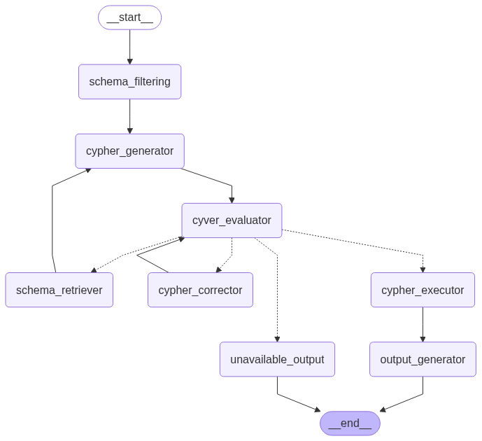
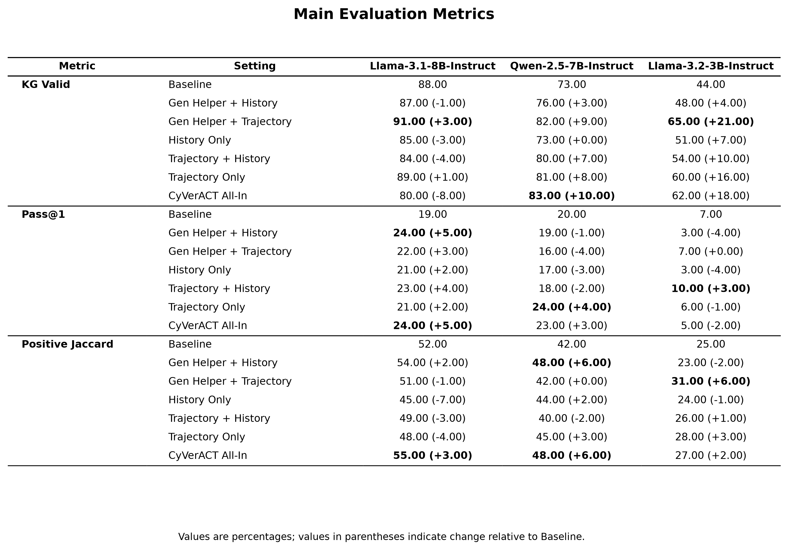

# Agentic Memory for CyVerACT

This repository contains the original **CyVerACT** Text-to-Cypher workflow together with a memory-enhanced extension developed for the NTUA/ECE diploma thesis:

> **«Διαχείριση μνήμης σε συνομιλιακούς AI πράκτορες για την υποστήριξη ερωτημάτων πάνω σε γράφους γνώσης.»**

The extension investigates whether a conversational Text-to-Cypher agent can improve over repeated interactions by storing and retrieving previous successful queries, failed attempts, database errors, and correction trajectories in a dedicated Neo4j memory graph.

The main implementation is under [`CyVerACT/extended_workflow`](CyVerACT/extended_workflow).

---

## Overview

The extended workflow keeps CyVerACT's validation-and-correction loop and adds structured long-term memory at three points:

- **History** — short-term access to previous failed Cypher attempts and their validation errors.
- **Trajectory retrieval** — retrieval of similar historical failures and correction trajectories from the memory graph.
- **Generator helper** — retrieval of semantically similar previously resolved questions before Cypher generation.

The final workflow follows the sequence:

`Schema Filtering → Cypher Generator → CyVer Evaluator → Cypher Corrector / Cypher Executor → Output`

When the filtered schema is insufficient, the workflow transitions to the full database schema and continues the correction loop. The evaluator uses CyVer validators for syntax, schema and property-level errors.



---

## Memory architecture

Long-term memory is stored in a separate Neo4j database from the target knowledge graph.

```text
(Question)-[:RESOLVED_WITH]->(Answer)
    |
    +--[:HAS_ATTEMPT]->(Attempt)
                           |
                           +--[:CAUSED_ERROR]->(CypherError)
                                                    |
                                                    +--[:HAS_ERROR_TYPE]->(ErrorType)
                                                                               |
                                                                               +--[:FIXED_WITH]->(FixRule)
```

The memory graph stores three vector representations using `all-MiniLM-L6-v2` embeddings with 384 dimensions and cosine similarity:

| Representation | Neo4j vector index | Purpose |
|---|---|---|
| `Question.embedding` | `question_embeddings` | Retrieve similar previously resolved questions |
| `CypherError.error_embedding` | `error_vector_embeddings` | Retrieve semantically similar database/validation errors |
| `CypherError.trajectory_embedding` | `trajectory_vector_embeddings` | Represent the structure of the failed correction trajectory |

The thesis implementation uses a question-similarity threshold of **0.93**. Trajectory retrieval combines error similarity and trajectory similarity using a **0.7 / 0.3** weighted score and retains candidates above **0.80**.

---

## Experimental configurations

The Movies knowledge-graph experiments compare seven configurations:

| Configuration | History | Trajectory retrieval | Generator helper |
|---|:---:|:---:|:---:|
| Baseline | — | — | — |
| History Only | ✓ | — | — |
| Trajectory Only | — | ✓ | — |
| Trajectory + History | ✓ | ✓ | — |
| Gen Helper + History | ✓ | — | ✓ |
| Gen Helper + Trajectory | — | ✓ | ✓ |
| All-In | ✓ | ✓ | ✓ |

`FixRule` knowledge is part of the structured correction memory and is not treated as an independent experimental dimension.

---

## Thesis experiment

The main thesis experiment uses the **Movies** Neo4j knowledge graph with three LLMs:

- Llama 3.1 8B Instruct
- Qwen 2.5 7B Instruct
- Llama 3.2 3B Instruct

For each model, the experiment uses **50 memory-population queries** and **100 evaluation queries**. The seven configurations above are evaluated independently.

Headline results for the best memory-enabled configuration of each model are shown below.

| Model | KG Valid — Baseline | KG Valid — Best | Pass@1 — Baseline | Pass@1 — Best |
|---|---:|---:|---:|---:|
| Llama 3.1 8B | 88% | 91% | 19% | 24% |
| Qwen 2.5 7B | 73% | 83% | 20% | 24% |
| Llama 3.2 3B | 44% | 65% | 7% | 10% |

The full evaluated tables and diagrams are available under [`CyVerACT/extended_workflow/Figures/Movies_Dataset`](CyVerACT/extended_workflow/Figures/Movies_Dataset).



---

## Multi-database extension

The repository also contains an extended benchmark built from five Neo4j demo databases:

`northwind`, `companies`, `twitch`, `grandstack`, and `recommendations`.

The combined dataset contains **500 evaluation queries** and **250 memory-population queries**. This extension is kept separate from the final Movies thesis experiment and is intended to test how the memory mechanisms generalize across heterogeneous schemas and larger result spaces.

The corresponding datasets are stored in [`CyVerACT/extended_workflow/Multi_DBs_Datasets`](CyVerACT/extended_workflow/Multi_DBs_Datasets).

---

## Repository structure

```text
agentic-memory/
├── README.md
├── CyVerACT/
│   ├── CyVer_custom/                 # CyVer validators
│   ├── data/                         # Original benchmark datasets
│   ├── qachain_workflow/             # QA-chain baseline workflow
│   ├── extended_workflow/            # Memory-enhanced CyVerACT workflow
│   │   ├── Agent_Memory/
│   │   │   ├── memory_driver.py
│   │   │   └── memory_manager.py
│   │   ├── Configuration/
│   │   ├── Edges/
│   │   ├── Nodes/
│   │   │   ├── States/
│   │   │   ├── cypher_generator.py
│   │   │   ├── cyver_evaluator.py
│   │   │   ├── cypher_corrector.py
│   │   │   └── cypher_executor.py
│   │   ├── Cognee_Graphiti_Memory/   # Exploratory external-memory prototypes
│   │   ├── Movies_DB_Datasets/
│   │   ├── Multi_DBs_Datasets/
│   │   ├── Outputs_Evaluation/
│   │   ├── New_Movies_Experiment_Metrics/
│   │   ├── Figures/
│   │   ├── init_vectors.py
│   │   ├── graph.py
│   │   ├── dataset_creation.ipynb
│   │   ├── get_main_workflow_results.ipynb
│   │   └── get_metrics_diagrams.ipynb
│   ├── requirements.txt
│   └── requirements_3_10_12.txt
├── cognee_requirements.txt
└── zep_requirements.txt
```

The `Cognee_Graphiti_Memory` directory contains exploratory prototypes used during framework comparison. These experiments are not part of the final evaluated memory architecture.

---

## Setup

### 1. Create a Python environment

Python 3.10 is recommended. A dependency snapshot for the Python 3.10.12 development environment is included.

```bash
python -m venv .venv
```

Windows:

```powershell
.venv\Scripts\activate
```

Linux/macOS:

```bash
source .venv/bin/activate
```

Install the CyVerACT dependencies:

```bash
pip install -r CyVerACT/requirements_3_10_12.txt
```

The broader environment snapshot is also available as `CyVerACT/requirements.txt`.

### 2. Configure environment variables

Create a local `.env` file. At minimum, the memory module requires a Neo4j connection:

```env
NEO4J_URI=neo4j://localhost:7687
NEO4J_USERNAME=neo4j
NEO4J_PASSWORD=your_password
```

Add the credentials required by the model provider you intend to use, for example:

```env
OPENROUTER_API_KEY=...
OPENAI_API_KEY=...
DEDICATED_HF_URL_LLAMA_3_1_8B=...
DEDICATED_HF_URL_LLAMA_3_2_3B=...
DEDICATED_HF_URL_QWEN_2_5_7B=...
```

Only the variables required by the selected model/provider need to be configured. Do not commit `.env` files or access tokens.

### 3. Initialize the memory vector indexes

From the extended workflow directory:

```bash
cd CyVerACT/extended_workflow
python init_vectors.py
```

This creates the three Neo4j vector indexes used by the memory manager.

---

## Running the experiments

The cleaned workflow is split into three notebooks so that dataset generation, workflow execution and evaluation remain independent.

### Dataset creation

Open:

```text
CyVerACT/extended_workflow/dataset_creation.ipynb
```

The notebook contains separate sections for the Movies dataset and the five-database extension. Existing final datasets are loaded if present; they are not regenerated unnecessarily.

### Workflow execution

Open:

```text
CyVerACT/extended_workflow/get_main_workflow_results.ipynb
```

Use this notebook to populate memory, run the selected model/configuration and save raw workflow outputs under `Outputs_Evaluation/`.

The active memory configuration is determined by the corresponding generator/corrector setup used for the experiment. Saved outputs in the repository preserve the completed thesis runs.

### Metrics and figures

Open:

```text
CyVerACT/extended_workflow/get_metrics_diagrams.ipynb
```

This notebook:

1. loads the raw workflow output files,
2. computes evaluation metrics when an evaluated file does not already exist,
3. stores evaluated files under `New_Movies_Experiment_Metrics/`, and
4. generates the final diagrams and metric tables under `Figures/Movies_Dataset/`.

---

## Evaluation

The evaluation pipeline reports both structural validity and semantic/output similarity metrics, including:

| Metric | Interpretation |
|---|---|
| KG Valid | Generated Cypher passes the CyVer validation pipeline |
| Pass@1 | Generated query output matches the reference output |
| Positive Jaccard | Output Jaccard similarity is greater than zero |
| Mean Jaccard | Average output-set overlap |
| BLEU | Token-level query similarity |
| ROUGE-L F1 | Longest-common-subsequence similarity |
| Jaro Similarity | Character-level query similarity |
| Jaccard Similarity | Query-token set similarity |

For the thesis experiment, output-based metrics are computed from database execution rather than from the truncated workflow display state.

---

## Important implementation notes

- The target knowledge graph and the long-term memory graph are logically separate Neo4j databases.
- The workflow first operates on a filtered schema and can fall back to the full schema after repeated correction attempts.
- Long-term successful-answer memory currently treats validator-clean, executable Cypher as a successful episode; semantic correctness is assessed separately by the evaluation pipeline.
- Retrieval thresholds and weighting coefficients are fixed experimental hyperparameters rather than learned values.
- Very large result sets in the multi-database benchmark require care during output-based evaluation. Truncating both queries to the first *N* rows is not considered equivalent to full-result Pass@1 evaluation.

---

## Key files

| File | Role |
|---|---|
| `extended_workflow/graph.py` | Compiles the LangGraph workflow |
| `extended_workflow/Agent_Memory/memory_manager.py` | Stores and retrieves episodic and trajectory memory |
| `extended_workflow/Agent_Memory/memory_driver.py` | Creates the Neo4j memory connection |
| `extended_workflow/init_vectors.py` | Creates memory vector indexes |
| `extended_workflow/Nodes/cypher_generator.py` | Generates Cypher and optionally uses retrieved successful examples |
| `extended_workflow/Nodes/cyver_evaluator.py` | Runs CyVer validators and records failed attempts |
| `extended_workflow/Nodes/cypher_corrector.py` | Corrects failed Cypher using history/trajectory context |
| `extended_workflow/Nodes/cypher_executor.py` | Executes validated Cypher and stores successful episodes |
| `extended_workflow/dataset_creation.ipynb` | Creates/loads the thesis datasets |
| `extended_workflow/get_main_workflow_results.ipynb` | Runs experiments and saves raw results |
| `extended_workflow/get_metrics_diagrams.ipynb` | Calculates metrics and produces final figures/tables |

---

## Project status

The **Movies knowledge-graph thesis experiment is complete**. The repository also contains an ongoing multi-database extension for evaluating the same memory mechanisms across five heterogeneous Neo4j databases.

This repository is research code. The final architecture prioritizes transparency, reproducibility and controlled ablation experiments over production-oriented concerns such as memory lifecycle management, learned retrieval policies and semantic verification before long-term memory promotion.