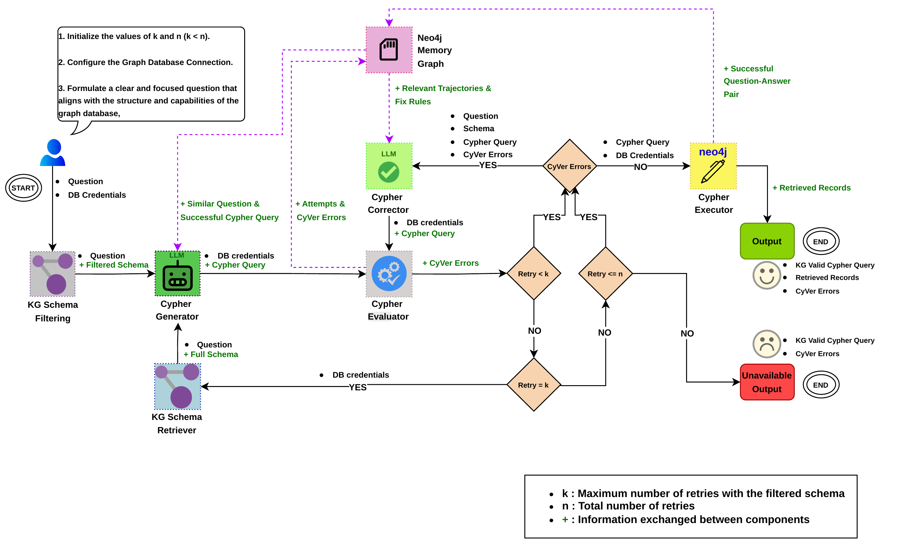
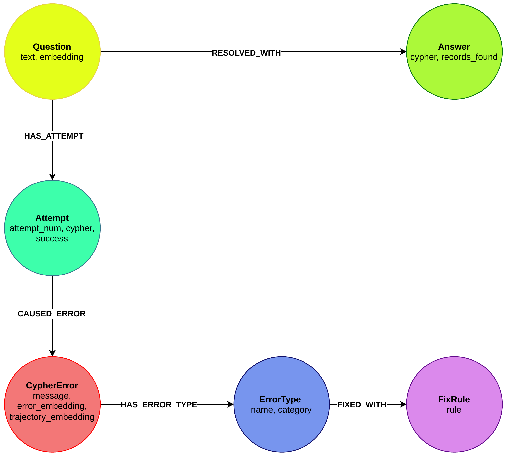
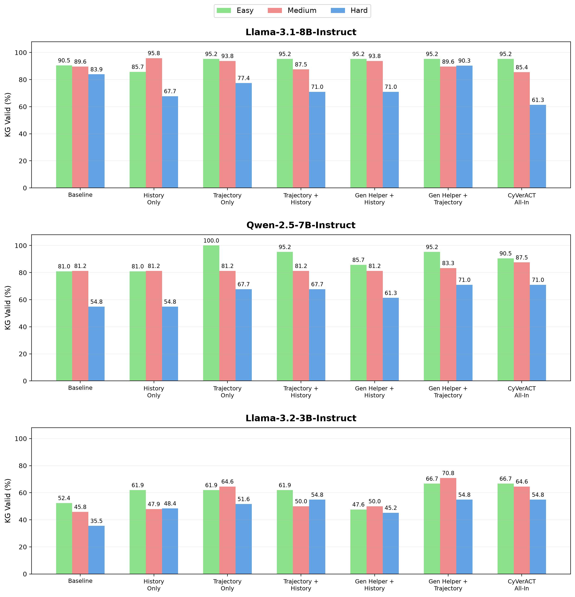

# Agentic Memory for CyVerACT

**Diploma Thesis — Olga Giannouchou**  
School of Electrical and Computer Engineering, National Technical University of Athens (NTUA), 2026

*Διαχείριση μνήμης σε συνομιλιακούς AI πράκτορες για την υποστήριξη ερωτημάτων πάνω σε γράφους γνώσης*

This repository contains the implementation developed for the diploma thesis, which extends the original **CyVerACT** Text-to-Cypher workflow with a Neo4j-based memory graph. The goal is to investigate whether previous successful queries and correction attempts can improve Cypher generation and validation.

The proposed extension combines **Generator Helper**, **short-term History**, **Trajectory Retrieval**, and predefined **FixRules** with the existing CyVer validation-and-correction loop.

## Memory-Enhanced Workflow



*Extension of the CyVerACT workflow with memory retrieval during generation and correction (thesis Figure 3.3; adapted from the original CyVerACT architecture).* 

## Neo4j Memory Graph



*The memory graph connects questions, Cypher attempts, validation errors, error types, correction rules, and successful solutions (thesis Figure 3.4).* 

## Experimental Results

The main evaluation used the **Neo4j Movies** graph, **100 evaluation questions**, **50 memory-population questions**, three language models, and seven memory configurations.

| Language model | Baseline KG Valid | Best KG Valid | Improvement | Best configuration |
|---|---:|---:|---:|---|
| Llama-3.1-8B-Instruct | 88% | 91% | +3 pp | Gen Helper + Trajectory |
| Qwen-2.5-7B-Instruct | 73% | 83% | +10 pp | CyVerACT All-In |
| Llama-3.2-3B-Instruct | 44% | 65% | +21 pp | Gen Helper + Trajectory |

*Summary of thesis Table 4.8. KG Valid measures technical validity, not semantic equivalence with the reference answer.*

### KG Valid by Query Difficulty



*Thesis Figure 4.12 — KG Valid across Easy, Medium, and Hard questions for all three language models and seven configurations. Values in parentheses indicate changes relative to the Baseline within each difficulty category.*

A further experiment included **500 evaluation questions across five Neo4j databases**. Full metrics, datasets, and experimental details are documented in the project Wiki.

## Reproducing the Workflow

The thesis implementation is under [`CyVerACT/extended_workflow/`](CyVerACT/extended_workflow/). Python **3.11**, a Neo4j instance, and an LLM provider key are required. Install the repository dependencies in a virtual environment:

```bash
pip install -r requirements.txt
```

The main notebooks are:

- [`run_reproducible_workflow.ipynb`](CyVerACT/extended_workflow/run_reproducible_workflow.ipynb) — single queries, custom Excel datasets (`single_db` or `per_row` connections), and Movies/MultiDB experiments with the seven runtime memory configurations.
- [`get_main_workflow_results.ipynb`](CyVerACT/extended_workflow/get_main_workflow_results.ipynb) — original Movies/MultiDB experimental workflow and archived-result organization.

For setup instructions, memory initialization, experimental configurations, metrics, and reproducibility notes, see the **[Project Wiki](/NETMODE/agentic-memory/-/wikis/home)**.

## Attribution

The memory extension and thesis experiments were developed by **Olga Giannouchou** on top of the original **CyVerACT** framework. See [`CyVerACT/README.md`](CyVerACT/README.md) for the original project, contributors, and benchmark references, and [`CyVerACT/LICENSE`](CyVerACT/LICENSE) for its license.